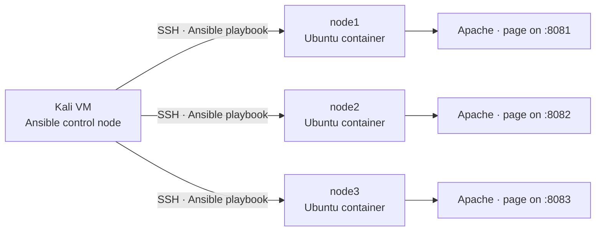
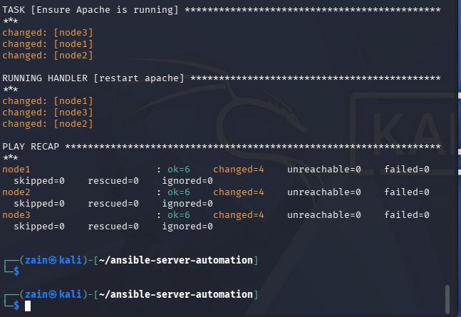
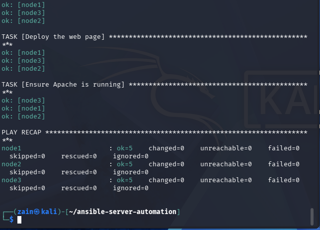
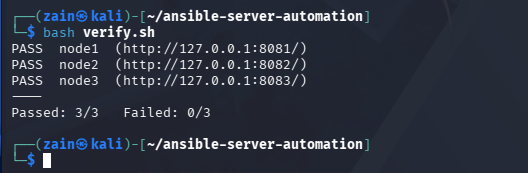
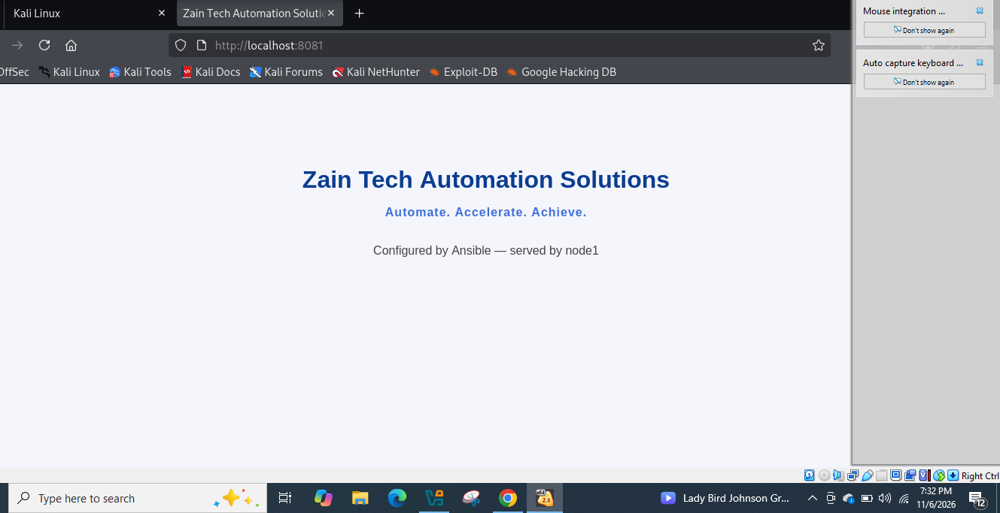

# Ansible Server Automation — Multi-Node Web Server Configuration

One Ansible playbook, run from a single control node, configures three Ubuntu servers identically: it installs Apache, deploys a branded web page to each one, and proves the setup is idempotent by running cleanly a second time.

## Architecture

Three disposable Ubuntu containers act as the managed servers. Each runs an SSH server and a `deploy` user (with passwordless sudo) whose authorized key is injected at image build time. Ansible connects over SSH, escalates with sudo, and leaves every node serving the same page — stamped with its own hostname.



| Node  | Container       | SSH (host → container) | Web (host → container) |
|-------|-----------------|------------------------|------------------------|
| node1 | `ansible-node1` | 2221 → 22              | 8081 → 80              |
| node2 | `ansible-node2` | 2222 → 22              | 8082 → 80              |
| node3 | `ansible-node3` | 2223 → 22              | 8083 → 80              |

## What the playbook does

`site.yml` runs against the whole `webservers` group with privilege escalation (`become: true`):

1. **Refreshes the package cache** (`apt update_cache`, cached for an hour so repeat runs stay fast).
2. **Installs Apache and curl** (`apache2`, `curl` — `state: present`, so nothing changes if they are already there).
3. **Deploys the web page** — renders `templates/index.html.j2` to `/var/www/html/index.html`. Each node gets the same page branded for **Zain Tech Automation Solutions**, with the line *"Configured by Ansible — served by \<hostname\>"* filled in from that node's own inventory name. A change here notifies the handler.
4. **Ensures Apache is running** (the `service` module; the containers run no systemd, so Ansible falls back to the SysV init script).

A single handler, **restart apache**, runs once per changed node at the end of the play — only when the page actually changed.

The playbook is idempotent: run it twice and the second run reports `changed=0`.

## Repository layout

| Path                          | Purpose                                                                 |
|-------------------------------|-------------------------------------------------------------------------|
| `site.yml`                    | The playbook: cache → packages → page → service, plus the Apache handler |
| `inventory.ini`               | The three nodes, the `deploy` user, key path, and lab SSH options        |
| `templates/index.html.j2`     | The web page template (hostname injected per node)                       |
| `verify.sh`                   | Curls all three web ports and prints PASS/FAIL per node                  |
| `targets/Dockerfile`          | Ubuntu 22.04 image: sshd, Python 3, sudo, `deploy` user, injected SSH key |
| `targets/docker-compose.yml`  | Builds and runs node1–node3 with their SSH/web port mappings             |
| `targets/authorized_keys`     | Placeholder — replace with your public key before building (step 2)      |

## Run steps

Everything runs locally on one machine (the Kali VM) — the "servers" are Docker containers on that same machine. No cloud account, no cost.

**1. Install Ansible on the control node**

```bash
sudo apt update && sudo apt install -y ansible
# or, if the distro package is unavailable:
# python3 -m pip install --user ansible
ansible --version
```

**2. Generate the lab SSH keypair and place the public key**

```bash
ssh-keygen -t ed25519 -f ~/.ssh/ansible_lab
cp ~/.ssh/ansible_lab.pub targets/authorized_keys
```

The Dockerfile bakes `targets/authorized_keys` into every target image, so this must happen **before** the build in step 3. If you rebuild the containers later, the same key keeps working — it is already in the inventory.

**3. Build and start the three target servers**

```bash
cd targets
docker compose up -d --build
docker compose ps
cd ..
```

**4. Check that Ansible can reach every node**

```bash
ansible -i inventory.ini webservers -m ping
```

Expected: three `SUCCESS` replies with `"ping": "pong"`.

**5. Run the playbook**

```bash
ansible-playbook -i inventory.ini site.yml
```

The first run installs Apache on all three nodes — expect `changed` counts on the package and template tasks, and the *restart apache* handler firing once per node.

**6. Run it again — idempotency check**

```bash
ansible-playbook -i inventory.ini site.yml
```

The second run should finish with `changed=0` for every node and no handler firing: the servers already match the desired state, so Ansible changes nothing.

**7. Verify the result**

```bash
./verify.sh
# or by hand:
curl http://127.0.0.1:8081/
curl http://127.0.0.1:8082/
curl http://127.0.0.1:8083/
```

## Expected results

- `verify.sh` prints `PASS` for node1, node2 and node3 — `Passed: 3/3`.
- Each page shows the Zain Tech Automation Solutions heading and *"Configured by Ansible — served by nodeN"*, with a different node name on each port.
- The playbook recap: first run `failed=0` with changes; second run `changed=0`, `failed=0`.

**Cleanup:** `cd targets && docker compose down` removes the lab. Rebuilding later is safe — the same keypair and inventory keep working.

## Verified run — 6 November 2026

The full lab was executed end to end on a local machine (Ansible core 2.22 as the control node, three Docker containers as targets):

| Step | Result |
|---|---|
| Connectivity check (`ansible -m ping`) | ✅ All 3 nodes replied `pong` over SSH key auth |
| First playbook run | ✅ node1/node2/node3: `ok=6, changed=4, failed=0` — Apache installed, page deployed, service started, restart handler fired |
| Second playbook run (idempotency) | ✅ node1/node2/node3: `ok=5, changed=0, failed=0` — nothing changed, exactly as designed |
| Live verification (`verify.sh`) | ✅ **Passed: 3/3** — each node serves its own page on ports 8081 / 8082 / 8083 |
| Live page in the browser | ✅ The Zain Tech Automation Solutions page served by node1 on `localhost:8081`, showing "Configured by Ansible — served by node1" |

**First run — configuration applied (PLAY RECAP):**



**Second run — idempotent, `changed=0` on every node (PLAY RECAP):**



**Verification — all three sites live:**



**The live page — served by node1:**


